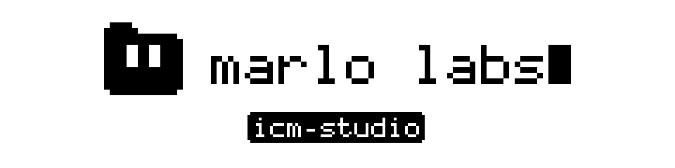
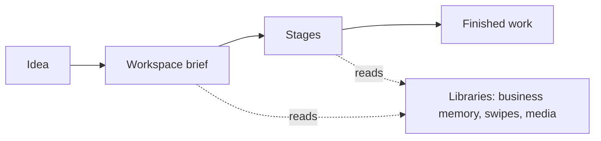

<p align="center">
  <picture>
    <source media="(prefers-color-scheme: dark)" srcset=".github/assets/banner-white-on-black.svg">
    
  </picture>
</p>

<p align="center">
  
  
  
</p>

Folders that turn an idea into finished work: animation, video, and copy. Open in Claude Code or Codex.

> **Status: preview.** This copy has the ICM core, the workspace builder, the three shared libraries, all three workspaces, and the shared render runtime. The worked examples land in the next release. Animation ships with looks, not characters: build your cast in its workshop.

## What You Can Make

| | Area | What it does |
|---|---|---|
| <picture><source media="(prefers-color-scheme: dark)" srcset=".github/assets/icons/animation-white-on-black.svg"></picture> | [Programmatic Animation](workspaces/programmatic-animation/CONTEXT.md) | Script to rendered animated short: build a cast, pick a look, render in code |
| <picture><source media="(prefers-color-scheme: dark)" srcset=".github/assets/icons/copywriting-white-on-black.svg"></picture> | [Copywriting](workspaces/copywriting/CONTEXT.md) | Brief to reviewed copy: posts, captions, emails, page copy |
| <picture><source media="(prefers-color-scheme: dark)" srcset=".github/assets/icons/video-white-on-black.svg"></picture> | [Video Production](workspaces/video-production/CONTEXT.md) | Footage edits, mixed media, motion graphics, and reel split tests |
| <picture><source media="(prefers-color-scheme: dark)" srcset=".github/assets/icons/workspace-builder-white-on-black.svg"></picture> | [Workspace builder](_core/workspace-builder/CONTEXT.md) | Builds a new ICM workspace for any job |
| <picture><source media="(prefers-color-scheme: dark)" srcset=".github/assets/icons/business-memory-white-on-black.svg"></picture> | [Business Memory](libraries/business-memory/CONTEXT.md) | Brand, voice, offers, and SOPs the agents read |
| <picture><source media="(prefers-color-scheme: dark)" srcset=".github/assets/icons/swipe-engine-white-on-black.svg"></picture> | [Swipe Engine](libraries/swipes/CONTEXT.md) | Save a reference, extract its patterns, curate it |
| <picture><source media="(prefers-color-scheme: dark)" srcset=".github/assets/icons/media-library-white-on-black.svg"></picture> | [Media Library](libraries/media/CONTEXT.md) | Find reusable media before sourcing new |

Animation and video render through the shared [`remotion/`](remotion/README.md) runtime.

## Quick Start

```bash
git clone https://github.com/JonG0ff/icm-studio.git
cd icm-studio
```

Open the folder in Claude Code or Codex. Then type `setup` in `libraries/business-memory/` to add your brand, or keep the demo brand, Acme Coffee Co.

## How It Works



- Each workspace is a folder of numbered stages.
- Each stage has a `CONTEXT.md`: its inputs, steps, checkpoints, and outputs.
- The agent reads only what the current stage needs.
- Outputs are files. Edit one and the next stage picks up your edit.
- You approve at checkpoints. Nothing ships without you.

## Examples

Worked examples for the demo brand land in the next release.

## Costs

The method, libraries, and workspaces are free. Some steps use paid services, such as ElevenLabs credits for voices or Magnific credits for AI clips. Every paid step says so and waits for approval before it spends.

## Contributing

See [CONTRIBUTING.md](CONTRIBUTING.md). Report security problems through [SECURITY.md](SECURITY.md).

## Credits

- Built on ICM, the Interpretable Context Methodology, by Jake Van Clief. Paper: https://arxiv.org/abs/2603.16021
- We apply the principles from his paper and repo. Credit and the original license are in [`_core/history/icm/`](_core/history/icm/README.md).
- Full notices: [NOTICE](NOTICE).

## License

MIT. See [LICENSE](LICENSE).

<p align="center"><sub>icm-studio by Marlo Labs. Built on ICM by Jake Van Clief.</sub></p>
